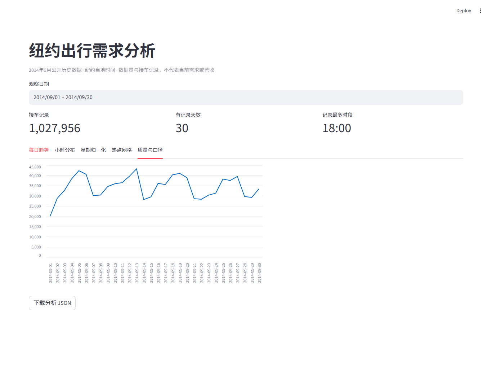

# 纽约出行需求分析看板

基于 Streamlit 官方纽约接车记录看板改造，保留上游数据、许可证、历史和原始入口。新增清洗、指标与分析界面由AI辅助实现。

上游：[github.com/streamlit/demo-uber-nyc-pickups](https://github.com/streamlit/demo-uber-nyc-pickups)。代码许可证：Apache-2.0。来源与边界见 [UPSTREAM.md](UPSTREAM.md)。



## 新增与改造

1. 重写streamlit_app.py，增加日期筛选、日趋势、24小时分布、星期归一化、热点网格及JSON下载。
2. demand_analysis.py读取完整公开数据，校验日期、经纬度及分析区域；纽约当地时间明确标注。
3. SQLite GROUP BY与Pandas独立计算每日聚合并自动核对，星期统计按实际有记录日期数归一化。
4. 保留同时间同坐标的记录，报告完全相同行数量；无订单ID时不能判定这些行是重复订单。

## 运行

Python 3.12。先创建并激活独立虚拟环境：

```sh
python -m venv .venv
# Windows: .venv\Scripts\activate
# macOS / Linux: source .venv/bin/activate
python -m pip install -r requirements-portfolio.txt
python demand_analysis.py
python -m streamlit run streamlit_app.py --server.headless true --server.address 127.0.0.1
```

## 验证

```sh
python -m pytest portfolio_tests -q --junitxml=.data/test-results.xml
```

新增套件本地验证：10项通过（2026-11-17，Windows / Python 3.12）。完整说明见 [docs/VALIDATION.md](docs/VALIDATION.md)。上游保留的测试、工作流和依赖不等同于本项目新增验证范围。GitHub Actions尚未启用。

## 统计与使用边界

- 数据来自上游随附2014年9月纽约Uber接车记录，历史数据不能代表当前城市需求。
- 没有订单ID、订单金额、曝光、司机供给或失败叫车量，不分析营收、转化或未满足需求。
- 分析区域为纬度40.0–41.2、经度-74.5–-72.5，区外记录在质量报告中单列。
- 1028136行原始记录，区外180行，保留1027956行；24037行完全相同记录被保留。
- CSV来源页面：https://github.com/fivethirtyeight/uber-tlc-foil-response；许可证说明只涉及代码，使用数据需同时查看原始数据来源要求。

公开仓库只包含技术材料、代码及公开或人工构造的数据。本地运行输出与个人文档默认忽略。
